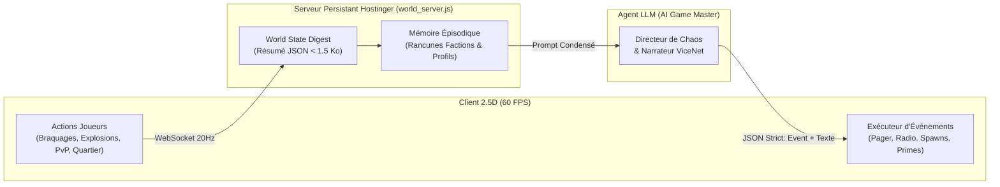

# 🧠 VICE CITY 26 — ARCHITECTURE LLM × SANDBOX ARCADE 2.5D

> **Pourquoi un univers 2.5D compact est un atout majeur pour les LLM :**
> Dans un jeu 3D AAA réaliste, un LLM ne peut presque rien improviser car chaque nouvelle situation exige des animations motion-capture, des caméras et du doublage.
> Dans le moteur **2.5D Top-Down de VICE CITY 26**, **toute la ville est représentée par un état JSON léger et déterministe** (quartiers, véhicules, piétons, police, météo, Pager, Radio, Smartphone, Cabines téléphoniques). Un LLM peut donc agir comme un véritable **Game Master temps réel** qui lit l'état du monde et déclenche de vraies actions physiques dans le moteur !

---

## 1. Architecture Hybride : Moteur 60 FPS Déterministe + Cerveau LLM Asynchrone

Le principe fondamental est de **ne jamais bloquer la boucle 60 FPS** :
- **Couche Moteur (`js/game.js`, `js/entities.js`, `js/net.js`) :** Gère la physique, le pathfinding, les tirs et la synchronisation WebSocket à 20 Hz / 60 FPS.
- **Couche Cognitive (`server/world_server.js` + API LLM / Petit modèle rapide) :** Tourne de manière asynchrone sur le serveur Hostinger (ou sur déclencheur d'événement toutes les 30 à 90 secondes) avec un **schéma JSON strict (Function Calling / Structured Output)**.



---

## 2. Les 4 Systèmes LLM Concrets pour VICE CITY 26

### Système 1 : Le "Directeur de Chaos" du Serveur Persistant (AI Game Master)
Toutes les 60 à 120 secondes (ou lors d'un pic d'action), le serveur construit un résumé ultra-compact (`WorldDigest`) de la room `VICE26` :
```json
{
  "room": "VICE26",
  "time": "22:15",
  "players": [
    { "name": "VALERIA_GT_12", "district": "SOUTH BEACH", "cash": 1868430, "wanted": 4, "veh": "BANSHEE_GT", "recentKills": 12 }
  ],
  "recentEvents": [
    "VALERIA_GT_12 exploded 4 VCPD cruisers on Ocean Drive",
    "Armored Truck robbed at Vice Port"
  ]
}
```
Le LLM renvoie une décision structurée en JSON que le serveur diffuse à tous les joueurs :
```json
{
  "eventType": "SERVER_BOUNTY_SWAT",
  "targetPlayer": "VALERIA_GT_12",
  "rewardCash": 25000,
  "radioFlash": "BREAKING NEWS on Flash FM! A maniac in a Banshee GT just torched four VCPD cruisers on Ocean Drive! Mayor offers $25,000 dead or alive!",
  "pagerAlert": "🚨 VCPD CONTRACT: Eliminate or wreck VALERIA_GT_12 in SOUTH BEACH for $25,000!",
  "spawnDirective": { "unit": "SWAT_ENFORCER", "count": 2, "nearPlayer": "VALERIA_GT_12" }
}
```

### Système 2 : Mémoire Rancunière des Factions & Boss ("2.5D Nemesis System")
La carte réduite compte **5 Factions / Figures clés** dotées d'une mémoire persistante par joueur dans `world_state.json` :
1. **Don Diaz / Star Island Cartel** (Star Island & Venezian Islands)
2. **Zoe Pound / Little Haiti Crew** (Little Haiti)
3. **Los Cabrones / Little Havana** (Little Havana)
4. **Biker Brotherhood** (Downtown)
5. **Captain Cortez / VCPD Tactical** (Commissariats & Fourrière)

- **Comment ça marche :**
  - Si un joueur vole régulièrement les voitures de luxe sur *Star Island* ou attaque les gardes, le score `grudge["STAR_CARTEL"][playerName]` augmente.
  - Le LLM génère un SMS / Pager personnalisé du Boss mentionnant **exactement** le dernier acte du joueur (ex. *"Tu crois que j'ai pas vu qui a volé ma Turismo jaune sur Star Island, VALERIA ? Mes gars t'attendent au pont Est."*).
  - La faction déclenche une embuscade ciblée ou offre au contraire un contrat très lucratif si le joueur s'est attaqué à une faction ennemie !

### Système 3 : Contrats "Fixer" Générés à la Volée aux Cabines Téléphoniques (`PAYPHONE_BOOTH`)
Lorsque le joueur s'approche d'une cabine téléphonique qui sonne :
- Au lieu de répéter toujours la même mission scriptée, le moteur inspecte les entités réellement présentes dans un rayon de 400 mètres autour du joueur (un bus sur Washington Ave, une voiture de sport garée devant un hôtel, une escouade de flics, un bateau au ponton).
- Le LLM assemble en JSON un **Micro-Contrat Arcade de 90 secondes** combinant 1 à 2 briques atomiques du moteur :
  - `HIJACK_SPECIFIC_VEHICLE` (Voler tel véhicule précis avant qu'il ne quitte le quartier)
  - `RAM_AND_EXTORT` (Percuter la limousine d'un banquier jusqu'à ce qu'il lâche la mallette)
  - `HOT_DELIVERY` (Livrer un véhicule piégé à telle adresse sans descendre sous 60 mph)
  - `CLEANUP_WITNESSES` (Éliminer une cible protégée et semer les 3 étoiles en moins de 90s)

### Système 4 : Radio "Vice City Live" & Fil Social Réactifs aux Joueurs
- Le fil d'actualité du téléphone in-game et les bandeaux **FLASH FM BREAKING NEWS** réagissent aux faits réels du serveur :
  - Un joueur se fait dévorer par un requin au large ? Le DJ se moque de lui par son pseudo à l'antenne.
  - Un embouteillage monstre explose en réaction en chaîne à un carrefour ? Le flash trafic annonce le carambolage exact et le quartier concerné.
  - Un joueur bat un record ou rachète un commerce ? Toute la ville en parle.

---

## 3. Garde-fous Techniques (Anti-Hallucination & Coût Zéro/Minimal)
1. **Grammaire JSON Fermée :** Le LLM ne génère jamais de code arbitraire ; il choisit uniquement parmi un catalogue d'actions validées par le moteur (`SPAWN_CONVOY`, `SET_BOUNTY`, `SEND_PAGER`, `TRIGGER_AMBUSH`, `CREATE_PAYPHONE_CONTRACT`) et des `specKey` existants (`VICE_CHEETAH`, `SWAT_ENFORCER`, `BRINKS_TRUCK`, etc.).
2. **Mise en Cache & Déclenchement sur Événement :** Les appels LLM ne se font **jamais par frame**, mais uniquement sur événement significatif (toutes les 45–90 secondes au niveau du salon, ou à l'activation d'une cabine téléphonique), ce qui représente une consommation de tokens infime.
3. **Fallback Procédural Instantané :** Si l'API LLM met plus de 1,5 seconde ou est hors ligne, un générateur de templates déterministe prend le relais en 0 ms pour que le rythme arcade ne ralentisse jamais.
